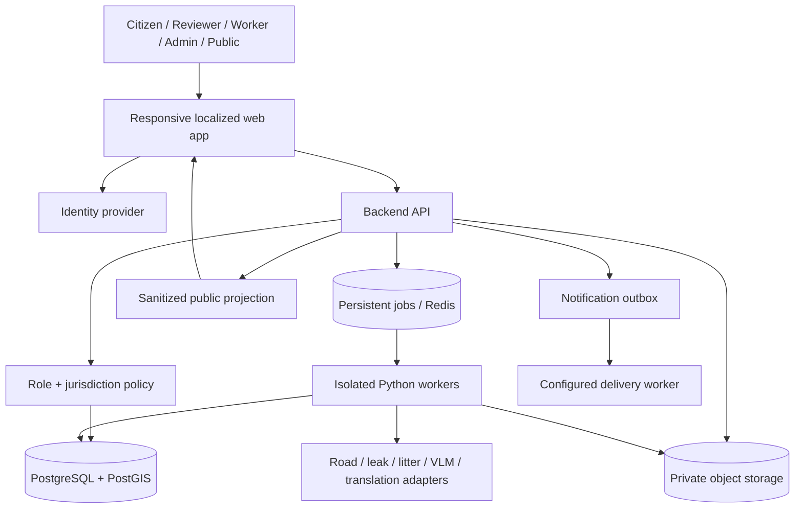

# FixProof — Master Build Specification & Antigravity Execution Prompt

> **Purpose of this file:** Give this single `README.md` to Antigravity as the authoritative product, architecture, workflow, AI/ML, UI/UX, security, testing and phased implementation specification for FixProof.
>
> **Product direction:** Village-first civic technology pilot, with village wards as first-class units and an architecture that can expand to towns and cities.
>
> **Languages:** English, Kannada and Hindi.
>
> **Build rule:** Do not attempt to generate the entire product in one giant step. Inspect first, plan, then implement one complete, tested phase at a time. Stop at each phase gate and report what works, what remains, and what decision is needed before proceeding.

---

# 0. MASTER INSTRUCTION TO ANTIGRAVITY — READ BEFORE CODING

You are acting simultaneously as:

- Senior UI/UX Developer.
- Senior Web Developer.
- Senior Software Architect.
- Senior AI/ML Engineer.
- Senior Backend and Full-Stack Engineer.
- Civic Technology Product Designer.
- A normal citizen who is frustrated because a public complaint was submitted but never resolved.

Your job is to turn the existing FixProof repository into a real, secure, responsive and working civic complaint and repair-verification website.

## 0.1 First action: inspect, do not overwrite

Before writing or changing code:

1. Inspect the complete repository, including all folders, source files, package manifests, environment examples, database files, assets, routes, components, API calls and existing documentation.
2. Identify the current frontend framework, routing system, styling system, backend, database, authentication and deployment setup.
3. Run the existing application and tests if possible. Record the exact commands and any failures.
4. Create a concise repository assessment:
   - What already works.
   - What is incomplete.
   - What is broken.
   - What can be reused.
   - What must be added.
   - What must not be replaced.
5. Preserve existing working frontend pages, components, styles, branding and integrations. Do not rewrite the project simply because you prefer another framework.
6. If the repository is empty or has no usable frontend, use the recommended stack in this README. If a migration is genuinely necessary, explain the reason and propose it before making destructive changes.
7. Inspect Git status and never delete or overwrite uncommitted user work.
8. Create a build plan and a task checklist before implementation.

**Do not start by generating every page, database table, API and AI model at once.** Start with Phase 0 and Phase 1 only. Finish and test each phase before moving to the next. Do not silently skip a phase.

## 0.2 Non-negotiable engineering rules

- Build real end-to-end functionality. A button is not complete until it performs its intended action and handles success, loading, empty and error states.
- Do not use fake API responses, hard-coded success messages, random AI results, fake map pins, fabricated analytics or mock model predictions in production flows.
- Demo seed data is allowed only when clearly labelled as sample/demo data.
- Never claim that an AI model is integrated until a real checkpoint is loaded and inference has been executed successfully.
- Never claim a government department, SMS, WhatsApp, email, map or payment integration exists unless credentials, authorization and a real end-to-end test prove it.
- Do not invent official ward boundaries, department names, staff contacts, legal service deadlines or government workflows.
- Use configuration for local government structures and routing.
- AI is advisory. Humans decide duplicate linking, priority, department assignment, repair approval and closure.
- Manual reporting and the complete complaint lifecycle must work when AI, maps, translation, notifications or network services fail.
- Every privileged backend action must be authorized on the server. Hiding a frontend button is not security.
- Keep secrets out of source control, frontend bundles, logs and model repositories.
- Use database migrations, typed API contracts, structured logs, tests and reproducible setup instructions.
- Prefer a modular monolith with isolated background workers. Do not create unnecessary microservices for the pilot.
- Do not put image/video/audio bytes in database rows as base64. Store files in object storage and metadata in the database.
- Use stable internal codes for categories, roles and statuses. Translate labels in the UI.
- Keep all important actions auditable.

## 0.3 Work in small deliverable slices

At the end of every phase:

1. Run formatter, lint, type checks and relevant automated tests.
2. Run the application and manually test the actual user journey.
3. Fix failures before proceeding.
4. Update this README's implementation checklist or create a short `IMPLEMENTATION_LOG.md`.
5. Report changed files, migrations, commands, test results, known limitations and next phase.
6. Stop and wait for the user/owner to approve continuing to the next phase.

If a dependency, model checkpoint, dataset or external service cannot be downloaded or used, do not fabricate it. Explain the blocker, implement a clean adapter/interface and continue only with features that can be honestly completed.

---

# 1. PRODUCT VISION

FixProof is a multilingual civic complaint, infrastructure issue triage, work tracking and repair verification platform.

Citizens report problems such as:

- Damaged roads, potholes and visible cracks.
- Visible water leakage.
- Garbage and litter accumulation.
- Drainage issues and waterlogging.
- Broken or non-working streetlights.
- Damaged public facilities.
- Other public infrastructure issues.

FixProof helps citizens submit evidence and track progress. It helps authorized local staff review complaints, identify possible duplicates, prioritize work, assign responsible teams and record repair evidence. It makes approved progress visible through citizen timelines and a sanitized public dashboard.

## 1.1 The core problem

A person reports a pothole, but does not know which office or department is responsible. Other people report the same pothole separately. Staff may not know which reports describe the same physical issue. A worker may say the issue is repaired, but citizens cannot see what was done. A complaint may be marked closed without independent verification.

FixProof provides a traceable workflow from first report to independently reviewed resolution.

## 1.2 The most important data distinction

**A citizen submission is not the same thing as a physical issue.**

- A `submission` is one person's report, description, location and evidence.
- An `issue` is the shared record for one real-world physical problem.
- Multiple submissions may be linked to one issue.
- Every submission and its original evidence must remain preserved.
- Nearby reports must not be merged automatically.

This distinction is fundamental. Do not design a database where duplicate submissions are deleted or overwritten.

## 1.3 Product goals

1. Make reporting easy on low-cost mobile devices.
2. Support English, Kannada and Hindi throughout the interface.
3. Support Gram Panchayat, village and village ward configuration.
4. Make ward-wise and village-wise accountability possible.
5. Keep the full manual workflow usable without AI.
6. Suggest relevant AI findings with clear limitations.
7. Route work only through verified jurisdiction and configured department rules.
8. Require independent human review before an issue is resolved.
9. Protect citizen identity, precise location and private media.
10. Expand to urban local bodies and multiple localities without a separate codebase.

## 1.4 What FixProof is not

- Not an emergency response or emergency dispatch service.
- Not a certified engineering inspection system.
- Not a guarantee that a government authority will repair an issue.
- Not a live government integration unless separately authorized and implemented.
- Not a tool that can determine road depth, water flow rate, toxicity, electrical safety or structural integrity from an ordinary photograph.

Use honest wording in all screens and demonstrations.

---

# 2. USERS, ROLES AND PERMISSIONS

Implement role-based access control (RBAC) with jurisdiction scope. A user's role must be stored and checked by the backend, not trusted from a client request.

## 2.1 Citizen

Can:

- Register, sign in and manage basic profile/preferences.
- Select English, Kannada or Hindi.
- Create, save, edit and submit own drafts.
- Submit a complaint with category, description, photo and location.
- See AI suggestions and accept, correct or skip them.
- View possible related issues and say same issue, different issue or not sure.
- Track own submissions and public issue status.
- Follow an issue and receive updates.
- Confirm whether a reported repair appears complete.
- Give feedback, dispute a resolution or report a recurrence.
- Request account/data actions according to the configured policy.

Cannot:

- View another citizen's private submission, phone number, private evidence or exact private coordinates.
- Assign workers, change official priority or approve closure.
- Change roles or jurisdiction configuration.

## 2.2 Authority reviewer / Panchayat staff

Can, only within assigned jurisdiction:

- View review inbox.
- Check report completeness and evidence.
- Correct category and locality details with an audit reason.
- Confirm or correct village/ward mapping.
- Review duplicate candidates and decide whether to link submissions.
- Set or confirm priority with reasons.
- Select a configured department and assign a worker/team.
- Request more information.
- Reject spam/invalid reports with a reason.
- Review repair evidence.
- Approve resolution, request better evidence or reopen an issue.
- Respond to citizen disputes.

Cannot approve a repair they personally submitted as a field worker if separation-of-duty policy forbids it. Enforce reviewer/worker separation for the same assignment.

## 2.3 Field worker

Can:

- See assigned tasks within their scope.
- Accept or decline an assignment with a reason.
- View operational location and work instructions.
- Update status and add progress notes.
- Upload before/during/after work evidence.
- Request resolution review.
- Report that access is blocked, parts are unavailable or work needs escalation.

Cannot:

- Assign work to themselves outside authorized workflow.
- Change official jurisdiction or grant roles.
- Approve their own repair as resolved.
- Delete audit history or original evidence.

## 2.4 Locality / platform administrator

Can:

- Configure organization and locality hierarchy using authorized records.
- Create and manage village, ward and urban locality units.
- Configure departments, category routing and jurisdiction scopes.
- Invite staff and assign roles with scope.
- Configure categories, SLA policies, language content and notification settings.
- Configure model adapters and approved model versions.
- Review moderation queues and operational analytics.
- Manage retention, publication and data access policies.

Privileged actions require strong authentication, server-side checks and audit events.

## 2.5 Public visitor

Can view only approved public information:

- Sanitized issue summary, category, status and generalized location.
- Public timeline entries approved for publication.
- Approved/sanitized evidence.
- Aggregated village/ward/category statistics.
- Public dashboard and map/list views.

Cannot view reporter identity/contact details, private original media, exact sensitive coordinates, staff-only notes or private dispute details.

---

# 3. GEOGRAPHY AND VILLAGE WARD SYSTEM

Village wards are first-class supported units. Do not treat wards as an afterthought or a text label.

At the same time, do not assume that every village, Gram Panchayat or district follows one identical hierarchy. Actual local administrative arrangements must be configurable from official/local records.

## 3.1 Flexible locality hierarchy

A possible rural configuration:

```text
State
└── District
    └── Taluk / Block
        └── Local Government Body (e.g. Gram Panchayat)
            ├── Village A
            │   ├── Ward 1 (where officially configured)
            │   ├── Ward 2
            │   └── Local area / street / hamlet
            └── Village B
                ├── Ward 1 (where officially configured)
                └── Local area / hamlet
```

A possible urban configuration:

```text
State
└── District
    └── Urban Local Body
        └── Zone
            └── Ward
                └── Street / locality
```

These are examples, not universal rules.

## 3.2 Locality data requirements

Use a configurable `locality_units` table or equivalent with:

- `id`
- `organization_id` / tenant scope where needed
- `unit_type` (state, district, taluk, block, gram_panchayat, village, ward, zone, urban_local_body, locality, street, hamlet, other)
- `parent_id`
- `official_code` (nullable)
- localized display names (`en`, `kn`, `hi`) or normalized translation records
- optional boundary geometry
- effective start/end dates
- active/inactive state
- source/verification metadata
- created/updated timestamps

Do not hard-code a single GP, village, ward count or district into application logic.

## 3.3 Complaint location fields

Store separately where applicable:

- local government body / GP
- village or urban locality
- ward (nullable)
- street/hamlet/landmark (optional)
- precise operational latitude/longitude (restricted)
- generalized public location (if publication is approved)
- location source: manual pin, one-time GPS, staff correction, boundary suggestion
- location accuracy/uncertainty when available

A citizen must be able to submit even when they do not know their ward. Provide **“I don't know my ward”** and allow village selection plus a manual map pin.

If verified ward boundary polygons exist, the backend may suggest a ward using spatial lookup. Store the suggestion source and confidence. An authorized reviewer must be able to correct it. Never infer official boundaries from a village name, generic geocoder result or AI image.

## 3.4 Ward dashboard and accountability

Every ward-aware dashboard must support filters and counts for:

- Total unique issues.
- Total citizen submissions.
- Open issues.
- Under-review issues.
- Assigned issues.
- In-progress issues.
- Repair reported, awaiting verification.
- Independently reviewed resolved issues.
- Reopened issues.
- Overdue issues according to configured operational targets.
- Median/average age by status where meaningful.
- Category distribution.
- Department workload.

**Do not count multiple submissions for one issue as multiple unique issues.** Show submissions and issues as separate metrics. Do not label an operational target as a statutory deadline unless verified.

---

# 4. COMPLETE END-TO-END USER WORKFLOW

## 4.1 Locality and organization setup

1. Admin creates the pilot organization/local government body.
2. Admin configures district, taluk/block, Gram Panchayat/local body, villages and wards from authorized local records.
3. Admin imports or enters official codes, localized names and verified boundaries when available.
4. Admin configures departments and the complaint categories they can handle.
5. Admin maps departments to jurisdiction scopes.
6. Admin configures category-to-department routing rules.
7. Admin invites authority reviewers and field workers.
8. Every staff role receives a defined jurisdiction scope.
9. Admin tests map points against configured ward boundaries, including gaps and overlaps.
10. An authorized reviewer confirms configuration before the pilot is enabled.

If official ward polygons are not available, use manual ward selection and reviewer correction. Do not invent them.

## 4.2 Citizen reporting workflow

1. Citizen opens FixProof and selects English, Kannada or Hindi.
2. Citizen chooses a category:
   - Road damage.
   - Water leakage.
   - Garbage/litter.
   - Drainage/waterlogging.
   - Streetlight.
   - Public facility.
   - Other / Not sure.
3. Citizen adds a short description. Keep text optional where category and evidence are sufficient.
4. Citizen uploads one or more supported photos.
5. Citizen selects local body/GP, village and ward if known.
6. Citizen may grant one-time location permission or place a manual pin.
7. GPS must be optional. Never require continuous tracking.
8. Explain which details are private and which may be public.
9. Save the draft before any AI processing.
10. Upload files to private quarantine storage.
11. Backend validates actual file signature, allowed type, size, dimensions, decodability and scanning/processing policy.
12. Create safe derivatives for analysis/preview. Keep originals private.
13. Enqueue AI analysis as a background job.
14. Show AI suggestions only when real model output is available.
15. Citizen may accept, correct or skip suggestions.
16. Search nearby issues and show possible matches with a reason.
17. Citizen chooses:
    - This is the same problem.
    - This is a different problem.
    - Not sure.
18. Preserve the citizen's submission regardless of duplicate decision.
19. Submit and show tracking ID, current status, selected village/ward if known and next step.

If AI fails, upload fails temporarily or the map service is unavailable, preserve the draft and provide a clear manual retry/fallback.

## 4.3 Duplicate candidate workflow

1. Backend searches nearby issues using PostGIS and compatible categories.
2. Search radius is configurable and accounts for location uncertainty and local road layout.
3. Candidate ranking may use distance, time, description and validated image similarity.
4. UI explains why an issue is suggested. Do not show unsupported certainty.
5. Citizen can confirm, reject or defer.
6. Reviewer can independently confirm/reject.
7. If confirmed, link the new submission to the existing issue.
8. Do not delete the new submission, evidence or reporter history.
9. If rejected, keep a separate issue.
10. If uncertain, leave it separate and flag for review.
11. Record decision actor, time, method, model version and scores where applicable.

**Never auto-merge based only on distance or image similarity.** Two potholes can be close together but distinct.

## 4.4 Authority review and routing

1. New submission appears in the correct jurisdiction review inbox.
2. Reviewer checks category, description, evidence and location.
3. Reviewer confirms/corrects village and ward.
4. Reviewer checks possible duplicate candidates.
5. Reviewer confirms issue grouping.
6. System suggests department using configured category + jurisdiction rules.
7. Reviewer confirms the department and worker/team.
8. Reviewer confirms priority and records reasons.
9. System records assignment and notifies the assigned team.
10. If information is missing, reviewer requests it and the citizen is notified.
11. If invalid/spam, reviewer rejects with a reason and audit event.

Do not invent a department or staff member if configuration is missing. Put the issue into an admin configuration queue.

## 4.5 Worker workflow

1. Worker opens assigned task.
2. Worker reviews category, location, reporter context approved for staff, instructions and priority.
3. Worker accepts or declines with reason.
4. Worker marks work in progress.
5. Worker adds progress updates and optional evidence.
6. Worker can mark blocked, needs materials, inaccessible or requires escalation.
7. Worker performs the repair outside the application.
8. Worker uploads after-photo(s), description of work performed and completion time.
9. Worker submits for independent resolution review.
10. Issue moves to `REPAIR_REPORTED` / `RESOLUTION_REVIEW`, not directly to resolved.

## 4.6 Independent repair verification

1. Reviewer sees original evidence and repair evidence side by side.
2. Ask for similar-angle after-photo and a wider context photo when practical.
3. Optional AI assistance may return:
   - `visible_change`
   - `possible_mismatch`
   - `insufficient_evidence`
4. AI result is only a prompt for human review.
5. Reviewer chooses:
   - Approve resolution with explanation.
   - Request better evidence.
   - Keep issue in progress.
   - Reopen with reason.
6. Worker cannot approve their own repair.
7. After approval, publish only approved sanitized data/media.
8. Notify citizen/followers in their selected language.
9. Citizen can provide feedback or dispute.
10. A later nearby report may be flagged as recurrence; human reviewer confirms the relationship.

A missed AI detection does not prove a repair succeeded. Photos cannot certify hidden/subsurface quality or durability.

## 4.7 Citizen dispute and reopening

1. Citizen selects “This problem is not fixed” or submits a dispute.
2. Citizen may add a new photo and explanation.
3. Issue is marked `REOPENED` or routed to a dispute review state according to policy.
4. Reviewer checks the new evidence and prior resolution.
5. Reviewer may reopen work, request clarification or explain why the resolution stands.
6. Every decision and reason is recorded.
7. Citizen receives an update.

## 4.8 Public transparency workflow

1. Public API reads from a sanitized public projection/view, not unrestricted private tables.
2. Only approved fields and approved media are visible.
3. Public location may be generalized.
4. Public dashboard offers map and accessible list modes.
5. Filters: locality, village, ward, category, status and date.
6. Timeline distinguishes `repair reported` from `reviewed resolved`.
7. Counts distinguish unique issues from submissions.
8. Never expose private notes, reporter contact details or original private media.

---

# 5. STATUS LIFECYCLE AND BUSINESS RULES

Main lifecycle:

```text
DRAFT
  → SUBMITTED
  → UNDER_REVIEW
  → ASSIGNED
  → IN_PROGRESS
  → REPAIR_REPORTED
  → RESOLUTION_REVIEW
  → RESOLVED
```

Additional controlled states:

- `NEEDS_INFORMATION`
- `REOPENED`
- `REJECTED`
- `CANCELLED` only if configured policy permits, with reason

Rules:

- A duplicate relationship is not a status.
- A submission remains preserved after being linked to another issue.
- Backend validates actor, previous state, next state and reason.
- Every state transition creates an immutable application audit event.
- Rejection, cancellation, duplicate decision, reopening, assignment and closure require reasons where policy says so.
- No worker can self-approve resolution.
- Status changes must be transactional.
- Use idempotency keys for retryable create/submit/upload operations.
- Never show `RESOLVED` until independent review is approved.

---

# 6. PRODUCT FEATURES — REQUIRED SCOPE

## 6.1 Citizen experience

- Mobile-first home page.
- Clear “Report a problem” and “Track my reports” actions.
- Three-language interface.
- Simple guided reporting.
- Save draft and resume.
- Photo upload with progress and retry.
- Manual location selection.
- Optional GPS.
- Ward unknown option.
- AI suggestion review.
- Possible duplicate suggestions.
- Submission receipt/tracking ID.
- Status timeline.
- Follow issue.
- Notifications/preferences.
- Feedback and dispute.
- Accessibility and low-bandwidth behavior.

## 6.2 Staff and worker experience

- Role-specific dashboards.
- Jurisdiction-filtered inbox.
- Search/filter/sort and pagination.
- Issue details with evidence.
- Duplicate review.
- Category/location/priority confirmation.
- Department/worker assignment.
- Work status updates.
- Repair evidence upload.
- Independent verification queue.
- Dispute/reopen handling.
- Audit history.

## 6.3 Admin experience

- Organization/locality hierarchy.
- Village and ward configuration.
- Boundary upload/import and validation if supported.
- Department and routing configuration.
- Staff invitations and scoped roles.
- Category configuration.
- SLA/operational target configuration.
- Translation content review.
- Model version/health configuration.
- Moderation.
- Analytics.
- Audit log.
- Retention and publication policy.

## 6.4 Public dashboard

- Map/list toggle.
- Accessible table/list alternative.
- Village and ward filters.
- Category/status/date filters.
- Approved issue detail.
- Sanitized timeline.
- Approved before/after evidence.
- Ward-level aggregate metrics.
- Clear metric definitions.
- Do not expose private personal data.

## 6.5 Additional features and workflows

Implement in phases after the core lifecycle works:

1. **Ward accountability dashboard:** unique issues, submissions, open, overdue, repair reported, reviewed resolved, reopened.
2. **Operational SLA tracking:** configurable target by category/priority/department. Label as operational target, not statutory deadline unless verified.
3. **Escalation:** notify configured supervisor after configured thresholds. Never invent recipients.
4. **Explainable priority suggestion:** use reviewer-confirmed context such as reported obstruction, impact, time open and recurrence. Do not use popularity alone.
5. **Village issue map/heatmap:** generalized public location; exact private coordinates restricted.
6. **Asset register:** optional roads, drains, water points, streetlights and other assets; link issues to assets only when verified.
7. **Citizen post-repair feedback:** feedback does not replace independent review.
8. **Offline draft and retry:** save locally where technically safe; sync idempotently when online.
9. **Recurrence intelligence:** candidate links to prior resolved issues; human confirms.
10. **Department workload/fairness analytics:** aggregate and auditable.
11. **Public transparency report:** clear definitions and date range.
12. **Safe media redaction:** face, vehicle plate, phone number and sensitive private-property detail handling.
13. **Moderation and abuse prevention:** rate limits, spam reporting, duplicate abuse controls.
14. **Voice reporting/read-aloud:** only after validated Kannada/Hindi/English speech recognition and speech synthesis. Typed reporting must always remain available.
15. **Multi-GP, town/city and district expansion:** configuration and tenant/jurisdiction isolation.

---

# 7. AI/ML STRATEGY — REAL MODELS, NOT MOCK RESULTS

## 7.1 AI principles

AI assists. People decide.

- Use existing open-source Git repositories and model checkpoints where suitable.
- Inspect source code, dependency versions, model cards, licenses and checkpoint origin before use.
- A Git clone is not proof that pretrained weights were downloaded.
- Pin the exact Git commit, checkpoint version and checksum used.
- Isolate incompatible model environments.
- Do not run every model on every upload. Route by confirmed/suggested category.
- Run inference asynchronously in background workers.
- Record model version, checkpoint hash, input reference, output, latency and failure state.
- Keep human correction controls.
- If a model is not installed, loaded or validated, return `not_available` / `manual_review_required`, never fabricated predictions.
- Never allow model output to directly assign a worker, change permissions, merge issues or close a complaint.
- Never claim local accuracy without a representative held-out evaluation.

## 7.2 AI service architecture

```text
Citizen submission
      |
      v
Private media validation + safe derivative
      |
      v
Persistent AI job queue
      |
      v
Category router
  |       |        |         |           |
  v       v        v         v           v
Road    Leak     Litter    Optional     Translation
model   model    model     VLM          service
  |       |        |         |           |
  +-------+--------+---------+-----------+
                  |
                  v
       Structured inference result
                  |
                  v
          Store model run + audit
                  |
                  v
        Citizen/reviewer confirmation
```

Keep AI inference outside the browser request lifecycle. Use a persistent jobs table for a small pilot or Redis-backed queue if needed. A failed job must not lose a report.

## 7.3 Existing repositories to inspect and evaluate

These are candidate repositories from the project research. They are not guaranteed to be production-ready or accurate on local village photos. Antigravity must inspect the live repository contents and licenses before integrating them.

### A. Road damage detection — first AI priority

Repository: https://github.com/oracl4/RoadDamageDetection

Candidate task:
- Detect possible longitudinal cracks.
- Detect possible transverse cracks.
- Detect alligator cracking.
- Detect potholes.

Implementation instructions:
1. Clone the repository into a research/vendor area, not directly into the production API.
2. Inspect README, requirements, source code, model files and checkpoint download instructions.
3. Verify whether real checkpoint files are present or whether Git LFS/external download is required.
4. Review licenses for code, weights and training dataset independently.
5. Create an isolated Python environment/container.
6. Build a clean FixProof adapter around the model. Do not couple the main API to the original demo application.
7. Implement image preprocessing and structured output with bounding boxes, class labels, scores, model revision and inference time.
8. Add a health/readiness endpoint and a test image inference.
9. Evaluate on held-out local-style road photos before enabling citizen-facing suggestions.
10. If the candidate is incompatible or unsuitable, document the reason and propose a compatible alternative; do not pretend it worked.

Suggested output wording: “Possible road damage detected. Please confirm.”

### B. Visible water leakage — experimental

Repository: https://github.com/MSunusi/pipeline-leak-detection

Candidate task:
- Evaluate whether its leak detector can identify visible water leakage in ordinary street/public infrastructure images.

Implementation instructions:
1. Inspect repository code and actual checkpoint.
2. Check if checkpoint is a Git LFS pointer and download the real file if authorized.
3. Review dependencies, license, model provenance and security.
4. Isolate environment and implement an adapter.
5. Test on real-world street scenes, including puddles, rain, runoff, wet roads and unrelated water.
6. Do not equate industrial/pipeline dataset performance with municipal street performance.
7. Do not infer leak source, flow rate, pressure, water safety or severity from a bounding box.

Suggested wording: “Possible visible water leak; source and flow are not confirmed.”

### C. Litter detection — dataset/model candidate

Repository: https://github.com/pedropro/TACO

Candidate task:
- Evaluate visible litter detection using the TACO dataset/repository and a compatible detector.

Implementation instructions:
1. Inspect dataset license and class definitions.
2. Inspect the current repository's code and model availability. Do not assume its legacy detector is a ready-to-use modern service.
3. Decide whether to use a compatible existing checkpoint or train/fine-tune an appropriate detector only if data and compute allow.
4. Create an isolated adapter and record exact model/dataset revisions.
5. Evaluate on representative village street scenes and difficult negatives.
6. Keep manual reporting available if the model is not ready.

Suggested wording: “Visible litter may be present.”

### D. Optional vision-language model

Repository: https://github.com/QwenLM/Qwen3-VL

Candidate tasks:
- Produce a short factual description of visible content.
- Help compare whether two images appear to show a similar scene as an experimental duplicate-ranking signal.
- Help reviewers understand evidence.

Rules:
- Pin a specific model variant and revision based on available hardware.
- Do not download a model larger than the deployment can serve.
- Do not send private user media to an external provider without explicit disclosure and an approved data-processing arrangement.
- Treat model text as untrusted.
- Do not ask it to make legal, engineering or safety determinations.
- Do not let it auto-merge duplicates or approve repairs.

### E. Reused-image/copy detection — optional

Repository: https://github.com/facebookresearch/sscd-copy-detection

Candidate task:
- Identify possible reuse of an identical or near-identical image.

Rules:
- Inspect repository maintenance status, license, code compatibility and checkpoint access.
- SSCD-style copy detection is not the same as recognizing the same physical pothole from a different camera angle.
- Use only as one weak signal in duplicate review.
- Do not auto-merge reports.

### F. English/Kannada/Hindi dynamic translation

Repository: https://github.com/AI4Bharat/IndicTrans2

Candidate language identifiers:
- English: `eng_Latn`
- Kannada: `kan_Knda`
- Hindi: `hin_Deva`

Implementation:
1. Inspect official installation and model download instructions.
2. Select appropriate translation directions/checkpoints.
3. Pin code and model revisions.
4. Keep original user text unchanged.
5. Store translation separately and label it “Machine translated”.
6. Provide “View original”.
7. Cache by source text hash, source/target language and model revision.
8. Validate real Kannada and Hindi output with fluent reviewers.
9. If translation fails, show the original and a localized fallback message.

IndicTrans2 is text translation, not speech recognition or text-to-speech.

## 7.4 Model download and integration procedure

Antigravity must do this in a controlled way:

1. Create `services/workers/model_registry/` or equivalent.
2. Create a model register documenting repository URL, commit SHA, checkpoint source, checkpoint SHA256, license, task, class labels, input size, dependencies, hardware needs and validation state.
3. Clone only the selected repository revisions.
4. Inspect installation scripts before running them.
5. Do not install all model requirements into one shared environment.
6. Download checkpoint files from official/authorized sources and verify hashes where available.
7. Never commit large model weights or secrets into ordinary application Git.
8. Store weights in a controlled model volume or artifact store.
9. Build one adapter at a time.
10. Add a real smoke test that loads the checkpoint and runs inference on a fixture image.
11. Add a failure test for missing checkpoint, incompatible device and invalid image.
12. Expose readiness separately from liveness.
13. Do not mark a model `active` until smoke test and evaluation gates pass.

Suggested model service structure:

```text
services/
  workers/
    app/
      main.py
      jobs/
      media/
      registry/
      adapters/
        road_damage/
          adapter.py
          preprocessing.py
          postprocessing.py
          tests/
        water_leak/
          adapter.py
          tests/
        litter/
          adapter.py
          tests/
        vision_language/
          adapter.py
          tests/
        translation/
          adapter.py
          tests/
        duplicate/
          spatial_candidates.py
          image_similarity.py
        repair_review/
          comparison.py
    model-manifests/
      road-damage.yaml
      water-leak.yaml
      litter.yaml
      translation.yaml
```

## 7.5 AI response contract

Return structured, versioned results. Example only:

```json
{
  "job_id": "uuid",
  "status": "completed",
  "task": "road_damage_detection",
  "category_suggestion": "road_damage",
  "observations": [
    {
      "label": "pothole",
      "confidence": 0.0,
      "bbox": [0, 0, 0, 0]
    }
  ],
  "limitations": [
    "Image analysis does not measure depth or engineering severity."
  ],
  "requires_human_review": true,
  "model_id": "configured-road-model",
  "model_revision": "actual-commit-and-checkpoint-hash",
  "latency_ms": 0
}
```

Do not copy the example confidence or output as a real result. Populate only from actual inference. Store model scores separately from similarity scores.

## 7.6 Duplicate matching

Use a staged approach:

1. PostGIS proximity and locality/category compatibility retrieve candidates.
2. Time window and text similarity may rank candidates.
3. Validated image similarity may add a ranking signal.
4. Optional VLM comparison may be tested but cannot be treated as reliable identity proof.
5. Show candidate reasons and uncertainty.
6. Citizen/reviewer confirms or rejects.
7. Preserve both submissions and all evidence.

If no visual matcher is validated, ship spatial/category suggestions with human confirmation and clearly label the limitation.

## 7.7 Priority suggestions

Use transparent rules and reviewer confirmation. Possible factors:
- Citizen-reported obstruction or access impact.
- Category and context.
- Time open.
- Recurrence confirmed by staff.
- Configured local operational policy.

Do not infer depth, structural risk, electrical danger, toxicity or water flow from ordinary images. Do not use number of likes/reports as the only priority measure.

## 7.8 Repair evidence assistance

Compare before/after images and optionally return:
- `visible_change`
- `possible_mismatch`
- `insufficient_evidence`

Request similar-angle and context photos when practical. A missing detection does not prove repair. AI cannot certify hidden quality, durability or compliance.

## 7.9 AI evaluation gates

Use representative held-out data and difficult negatives. Prevent near-duplicate leakage across training and test sets. Record consent/source and usage rights.

Measure:
- Precision and recall per class.
- Confusion matrix.
- Localization metrics where appropriate.
- False positives on normal roads, puddles, wet surfaces and shadows.
- Performance on different lighting, weather, camera quality and viewpoints.
- Inference latency and memory on actual deployment hardware.
- Calibration and confidence behavior.

Do not compare models trained/evaluated on different datasets as if the comparison were fair. Confidence is not an accuracy guarantee. Report prototype evaluation, not municipal safety certification.

---

# 8. RECOMMENDED TECHNICAL ARCHITECTURE

Inspect and preserve the existing stack first. If no suitable stack exists, use:

| Layer | Preferred option | Responsibility |
|---|---|---|
| Web | Next.js + TypeScript | Responsive application and dashboards |
| Localization | next-intl | `/en`, `/kn`, `/hi` routes and message catalogs |
| UI | Existing design system or Tailwind + accessible component primitives | Consistent responsive components |
| API | FastAPI (Python) | Business rules, auth verification, workflows and model orchestration |
| Identity | Supabase Auth or existing secure identity provider | Authentication |
| Database | PostgreSQL + PostGIS | Relational data, spatial search, permissions |
| Storage | Supabase Storage private buckets or compatible private object storage | Original and derived media |
| Jobs | Persistent DB jobs table initially; Redis queue if needed | Background AI, notifications and processing |
| AI workers | Python isolated environments/containers | Real model inference |
| Maps | Licensed map provider with attribution and usage limits | Location selection and public map |
| Deployment | Web host + API/worker host + managed database/storage | Reproducible deployment |

Start as a modular monolith API with separate background worker process(es). Do not introduce microservices unless real scale or isolation needs justify them.

## 8.1 Logical architecture



## 8.2 Suggested repository structure

Adapt this to the repository already present. Do not move or rename existing files without a reason.

```text
fixproof/
├── README.md
├── IMPLEMENTATION_LOG.md
├── .env.example
├── apps/
│   └── web/
│       ├── app/
│       │   └── [locale]/
│       ├── components/
│       │   ├── common/
│       │   ├── citizen/
│       │   ├── reviewer/
│       │   ├── worker/
│       │   ├── admin/
│       │   └── public/
│       ├── features/
│       │   ├── auth/
│       │   ├── reporting/
│       │   ├── issues/
│       │   ├── locality/
│       │   ├── assignments/
│       │   ├── verification/
│       │   ├── analytics/
│       │   └── notifications/
│       ├── messages/
│       │   ├── en.json
│       │   ├── kn.json
│       │   └── hi.json
│       ├── lib/
│       └── tests/
├── services/
│   ├── api/
│   │   ├── app/
│   │   │   ├── main.py
│   │   │   ├── core/
│   │   │   ├── auth/
│   │   │   ├── profiles/
│   │   │   ├── localities/
│   │   │   ├── jurisdictions/
│   │   │   ├── departments/
│   │   │   ├── reports/
│   │   │   ├── issues/
│   │   │   ├── duplicates/
│   │   │   ├── media/
│   │   │   ├── assignments/
│   │   │   ├── work/
│   │   │   ├── verification/
│   │   │   ├── ai/
│   │   │   ├── translations/
│   │   │   ├── notifications/
│   │   │   ├── analytics/
│   │   │   └── audit/
│   │   ├── tests/
│   │   └── pyproject.toml
│   └── workers/
│       ├── app/
│       ├── adapters/
│       ├── model-manifests/
│       ├── tests/
│       └── pyproject.toml
├── database/
│   ├── migrations/
│   ├── policies/
│   ├── seeds/
│   └── tests/
├── packages/
│   └── shared-contracts/
├── tests/
│   ├── e2e/
│   ├── permissions/
│   ├── workflows/
│   ├── models/
│   └── localization/
├── infra/
│   ├── docker/
│   └── deployment/
└── docs/
    └── decisions/
```

If the existing repository uses a different structure, preserve it and map these modules into its conventions.

---

# 9. DATABASE DESIGN — REQUIRED ENTITIES

Use migrations and foreign keys. Use UUIDs or another consistent non-guessable ID strategy. Add indexes for common filters and geospatial queries.

Core entities:

1. `profiles` — user ID, display preferences, locale; separate private contact data.
2. `role_assignments` — user, role, department, jurisdiction scope, granting actor, validity.
3. `organizations` — pilot organization/local body and tenant boundary.
4. `locality_units` — configurable geography hierarchy including villages and wards.
5. `departments` — configured responsible teams.
6. `jurisdictions` — department/staff jurisdiction scope and geometry/rules.
7. `department_jurisdictions` — mapping of departments to jurisdiction units.
8. `issues` — shared physical issue, category, status, priority, owning locality/department and location.
9. `submissions` — one citizen report, reporter, issue link, original text/language, timestamps.
10. `media_assets` — storage object path, owner, submission/issue, evidence role, validation/publication state, hash.
11. `issue_followers` — unique user-to-issue relation.
12. `duplicate_candidates` — candidate pair, method, scores, model revision, decision and reviewer.
13. `assignments` — department, worker/team, assigner, status and timestamps.
14. `work_updates` — progress note, worker, event time and attachments.
15. `model_runs` — task, model/checkpoint/prompt version, input references, structured output, latency and errors.
16. `repair_reviews` — reviewer, evidence references, decision and explanation.
17. `disputes` — citizen dispute, evidence, review outcome.
18. `status_events` — actor, previous/next status, reason, timestamp.
19. `translations` — original reference/hash, source/target languages, output and model revision.
20. `notification_outbox` — recipient, event, locale, channel and delivery state.
21. `jobs` — persistent job status, retry count, lease and error metadata.
22. `audit_logs` — append-only privileged action history.
23. `sla_policies` — configured operational targets by category/priority/department/locality.
24. `assets` — optional verified public infrastructure asset register.
25. `public_issue_projection` — approved sanitized public representation or secure view.

## 9.1 Database requirements

- Use PostGIS for spatial filtering and ward boundary lookup.
- Use nullable ward reference where ward is unknown or not configured.
- Store original citizen text and language without overwriting.
- Store media bytes in object storage, never base64 in issue rows.
- Separate private operational location from generalized public location.
- Store all model output with version and source references.
- Add uniqueness constraints for followers and idempotency keys.
- Use transactional state transitions.
- Protect role assignments and audit tables from ordinary users.
- Ensure deletion/retention policy handles associated media and derived data.
- Test database restore together with media restore.

---

# 10. API CONTRACTS — PROPOSED ROUTE SURFACE

Adapt route naming to the existing backend but preserve equivalent behavior. All endpoints require validation, authentication where applicable, authorization, pagination and consistent error responses.

```text
# Auth/profile
GET    /me
PATCH  /me
GET    /me/reports

# Localities
GET    /localities
GET    /localities/{id}/children
GET    /localities/ward-suggestion
POST   /admin/localities
PATCH  /admin/localities/{id}

# Upload/media
POST   /uploads/authorize
POST   /uploads/{id}/complete
GET    /media/{id}/authorized-url

# Citizen reports
POST   /reports/drafts
PATCH  /reports/{id}/draft
POST   /reports/{id}/submit
GET    /reports/{id}
POST   /reports/{id}/analyze
GET    /reports/{id}/analysis

# Issues/duplicates
GET    /issues/nearby
GET    /issues/{id}
POST   /issues/{id}/join
POST   /issues/{id}/follow
DELETE /issues/{id}/follow
POST   /issues/{id}/dispute

# Staff review
GET    /staff/inbox
POST   /staff/issues/{id}/review
POST   /staff/issues/{id}/priority
POST   /staff/issues/{id}/assign
POST   /staff/duplicate-candidates/{id}/decision

# Worker
GET    /worker/tasks
POST   /worker/assignments/{id}/accept
POST   /worker/assignments/{id}/decline
POST   /worker/issues/{id}/updates
POST   /worker/issues/{id}/repair-evidence
POST   /worker/issues/{id}/request-review

# Independent review
GET    /review/resolution-queue
POST   /review/issues/{id}/resolution

# Public
GET    /public/issues
GET    /public/issues/{id}
GET    /public/analytics

# Notifications/translation
GET    /notifications
PATCH  /notifications/preferences
POST   /translations

# Admin
POST   /admin/departments
PATCH  /admin/departments/{id}
POST   /admin/roles
GET    /admin/audit
GET    /admin/models/health
```

Analysis endpoints should return `202 Accepted` with a job identifier when work is queued. Provide job status polling or a supported event channel. Never keep an HTTP request open for long-running model inference.

A browser must never select arbitrary storage paths or bypass authorization by changing an ID.

---

# 11. UI/UX DESIGN REQUIREMENTS

Act as a senior UI/UX designer. Design for real citizens, including people who are not technically confident.

## 11.1 Design principles

- Mobile-first and responsive from small Android screens to desktop.
- Clean, trustworthy civic-service aesthetic.
- Clear hierarchy and readable typography.
- Large touch targets and obvious primary actions.
- Short plain-language labels.
- Minimal steps to report an issue.
- Avoid clutter, excessive gradients, decorative animations and dashboard overload.
- Consistent spacing, cards, forms, buttons, status badges and dialogs.
- Good empty, loading, success, offline and error states.
- Keyboard accessibility and screen-reader labels.
- Do not rely on color alone to communicate status.
- Map must always have an accessible list alternative.
- Use real, relevant icons/illustrations; avoid meaningless stock imagery.
- Do not display fabricated charts or counts.

## 11.2 Suggested public routes/pages

Adapt to existing routing:

```text
/[locale]
/[locale]/login
/[locale]/register
/[locale]/report
/[locale]/report/[id]
/[locale]/my-reports
/[locale]/issues/[id]
/[locale]/public
/[locale]/public/issues/[id]
/[locale]/about
/[locale]/privacy
/[locale]/help
```

## 11.3 Citizen pages

- Landing/home page.
- Login/register.
- New complaint guided form.
- Upload and location step.
- AI suggestion confirmation step.
- Duplicate candidate step.
- Submission confirmation.
- My reports.
- Report detail and timeline.
- Issue detail/follow.
- Dispute/feedback.
- Notification preferences.

## 11.4 Staff pages

- Staff login.
- Review dashboard.
- Review issue detail.
- Duplicate candidate review.
- Assignment form.
- Department workload.
- Resolution verification queue.
- Dispute review.

## 11.5 Worker pages

- Assigned tasks.
- Task detail.
- Accept/decline.
- Progress update.
- Upload repair evidence.
- Request verification.
- Work history.

## 11.6 Admin pages

- Organization settings.
- Locality hierarchy.
- Village and ward configuration.
- Boundary management/validation.
- Department setup.
- Routing rules.
- Staff and scoped roles.
- Category settings.
- Operational SLA settings.
- Model configuration/health.
- Moderation.
- Analytics.
- Audit logs.

## 11.7 Public pages

- Public dashboard.
- Map/list.
- Filters.
- Issue detail.
- Ward/village accountability.
- Public reports/analytics.

## 11.8 Reporting form UX

Keep it guided and simple:

1. **Problem:** category + description.
2. **Evidence:** photo upload.
3. **Location:** local body, village, ward if known, map pin.
4. **Review:** privacy note, confirm details, submit.

Do not force citizens to understand departments or technical severity.

## 11.9 Dashboard UX

Citizen dashboard should show next action and clear timeline, not raw AI metrics. Staff dashboards may expose technical evidence and model provenance where useful. Public dashboard must use approved sanitized fields only.

---

# 12. LOCALIZATION — ENGLISH, KANNADA, HINDI

Use locale routes such as:

- `/en`
- `/kn`
- `/hi`

If using Next.js, use `next-intl` or a suitable equivalent.

## 12.1 Translate all static UI

Include:
- Navigation.
- Buttons.
- Form labels and placeholders.
- Validation errors.
- Categories.
- Status names.
- Upload progress.
- Map controls.
- Dashboard filters.
- Empty/loading/error states.
- Login and account messages.
- Evidence review labels.
- Notifications.
- Privacy/help content.
- Accessibility labels.

Use stable internal codes such as `UNDER_REVIEW`; translate the visible label through message catalogs.

Suggested files:

```text
messages/
  en.json
  kn.json
  hi.json
```

Persist user language preference. Switching language must not discard a draft or reset the current workflow. Set the document language correctly. Use fonts that support Kannada and Devanagari. Test long translations on mobile.

## 12.2 Dynamic complaint translation

- Preserve original language and text.
- Translate only when another language is requested/needed.
- Store translation separately with model version.
- Label as machine translated.
- Provide “View original”.
- Cache using content hash and language pair.
- Validate important content with fluent speakers.
- If translation fails, show original text and localized fallback.
- Do not translate names, IDs or coordinates as ordinary prose.

## 12.3 Voice features

Voice reporting and read-aloud are later features. Do not show a working voice feature until a real, validated speech recognition and speech synthesis pipeline supports the required languages. Audio upload alone is not voice understanding. Manual typed reporting remains available.

---

# 13. SECURITY, PRIVACY AND RELIABILITY

This section is a required engineering baseline, not a claim of completed certification.

## 13.1 Identity and permissions

- Verify identity tokens on the server.
- Enforce role + jurisdiction scope on every privileged endpoint.
- Use database row-level security where supported, plus API authorization.
- Never trust role, owner ID, department or locality scope sent by the browser.
- Restrict role grants and privileged admin operations.
- Require strong authentication/MFA for privileged accounts where available.
- Test cross-user and cross-jurisdiction access.

## 13.2 Media security

- Private buckets for originals, repair originals and quarantine.
- Validate actual file signature, not only browser MIME type.
- Restrict file types, size, pixel dimensions and video/audio duration.
- Decode in a sandboxed/isolated processing environment.
- Scan according to deployment policy.
- Use opaque object names; no user-controlled filesystem paths.
- Strip EXIF/GPS from public derivatives.
- Review/redact faces, number plates, phone numbers and sensitive private-property details before publication.
- If redaction is unavailable, keep media private pending manual review.
- Use short-lived signed URLs only after authorization.
- Do not let models fetch arbitrary user URLs or local filesystem paths.
- Do not claim GPS metadata proves authenticity.

## 13.3 Application security

- HTTPS.
- Secure session handling.
- Parameterized database queries.
- Request/schema validation.
- Output escaping.
- Rate limits and quotas.
- CSRF/origin protections appropriate to auth design.
- Idempotency keys.
- Timeouts and bounded retries.
- Audit privileged operations.
- Treat complaint text, image text and model output as untrusted input.
- Models cannot execute database writes or privileged actions.
- Keep secrets in server environment/secret manager, never in frontend code or Git.
- Redact personal data and tokens from logs.

## 13.4 Privacy

- Collect minimum contact information.
- Do not request Aadhaar or unrelated identity documents.
- Explain what is private and what may become public.
- Explain any third-party AI processing before enabling it.
- Keep precise operational location restricted.
- Generalize public location where necessary.
- Define retention and deletion policy before launch.
- Support account/data requests according to policy.
- Protect backups and test restore/deletion behavior.

## 13.5 Reliability

- Persist draft before AI.
- Persistent job queue with retries and dead-letter/error state.
- Idempotent upload completion and submission.
- Retry-safe notifications.
- Health and readiness endpoints.
- Database and media backups.
- Restore drills.
- Observability for API, worker and model latency/errors.
- Graceful degraded mode if AI, maps, notifications or translation are down.
- No data loss if a worker crashes mid-job.

---

# 14. NOTIFICATIONS

Implement an in-app notification system first.

Events:
- Submission received.
- More information requested.
- Issue linked to an existing issue.
- Review completed.
- Assignment created.
- Work started.
- Work update added.
- Repair evidence submitted.
- Resolution approved.
- Resolution rejected/requested more evidence.
- Issue reopened.
- Citizen dispute response.
- Configured operational SLA escalation.

Notification rules:
- Use the recipient's selected language.
- Store notification event and delivery state.
- Do not expose private information in public channels.
- Avoid duplicate notifications on retries.
- Email/SMS/WhatsApp/IVR are optional integrations and must not be shown as active until actually configured and tested.
- Provide preferences and unsubscribe/disable controls where appropriate.

---

# 15. ANALYTICS AND REPORTING

Create accurate analytics from real database records.

Metrics:
- Unique issues.
- Citizen submissions.
- Open issues.
- Assigned/in-progress.
- Repair reported.
- Independently reviewed resolved.
- Reopened.
- Overdue by configured target.
- Time to first review.
- Time to assignment.
- Time to repair report.
- Time to independent resolution.
- Category distribution.
- Village and ward distribution.
- Department workload.
- Recurrence count where confirmed.

Rules:
- Define every metric.
- Use correct distinct counts.
- Do not count submissions as unique issues.
- Do not count repair-reported as resolved.
- Do not expose personally identifying information.
- Use generalized location in public maps.
- Avoid misleading comparisons where sample sizes are small.

---

# 16. IMPLEMENTATION ROADMAP — STRICT PHASED EXECUTION

**Antigravity: implement only the current phase. Do not jump to later phases because the complete specification is visible.**

## Phase 0 — Repository audit and plan

Tasks:
- Inspect repository and run existing app/tests.
- Document current stack and existing functionality.
- Identify reusable UI and API components.
- Identify blockers and risks.
- Produce target architecture mapped to existing repository.
- Produce task breakdown and migration plan.

Acceptance gate:
- No destructive changes.
- Existing functionality and current failures documented.
- User/owner can understand what will be built next.

**Stop and report. Do not implement all features in this phase.**

## Phase 1 — Foundation and design system

Tasks:
- Set up/repair app startup and environment configuration.
- Establish responsive layout and navigation.
- Build design tokens, typography, form controls, cards, dialogs, alerts, loading and error states.
- Set up English/Kannada/Hindi static message catalogs.
- Build public landing page and role-based route shells.
- Create typed API client and consistent error handling.
- Add lint, format, typecheck and test scripts.

Acceptance gate:
- App starts reliably.
- Mobile and desktop layouts work.
- Language switching works without losing page state.
- No dead buttons or placeholder navigation.
- Existing frontend work is preserved.

**Stop and report.**

## Phase 2 — Database, identity and permissions

Tasks:
- Configure database and migrations.
- Implement profiles and role assignments.
- Implement locality hierarchy with village and ward support.
- Implement organization, department and jurisdiction configuration.
- Implement server-side identity verification.
- Add row-level/security policies.
- Add seed data clearly marked as demo.
- Add permission tests.

Acceptance gate:
- Users can sign in/out.
- Roles are enforced on backend.
- Staff scope is enforced by jurisdiction.
- Admin can configure villages and wards.
- Cross-user and cross-jurisdiction tests pass.

**Stop and report.**

## Phase 3 — Citizen reporting and secure media

Tasks:
- Build guided report form.
- Add category, description, locality, village, optional ward, manual pin and optional GPS.
- Add private photo upload with validation and safe derivatives.
- Persist draft before AI.
- Add submit confirmation and citizen report list.
- Add tracking detail/timeline base.
- Implement upload retry and idempotency.

Acceptance gate:
- Citizen can create, save, resume and submit a real report.
- Original evidence is private.
- Invalid/oversized file is rejected safely.
- Draft survives refresh/retry.
- Ward may be unknown and report still succeeds.

**Stop and report.**

## Phase 4 — Manual issue lifecycle and staff workflow

Tasks:
- Implement submission vs issue separation.
- Implement review inbox.
- Implement manual duplicate candidate decisions.
- Implement category/location correction and audit.
- Implement configured department routing.
- Implement assignment and worker task list.
- Implement worker acceptance, progress updates and repair evidence.
- Implement independent resolution review and dispute/reopen.

Acceptance gate:
- Full manual report-to-resolution journey works with AI disabled.
- Worker cannot approve own work.
- Duplicate submissions are preserved.
- Status transitions and audit events are enforced.
- Staff cannot access outside jurisdiction.

**Stop and report.**

## Phase 5 — Public dashboard, notifications and ward analytics

Tasks:
- Build sanitized public projection.
- Build public map/list and filters.
- Build in-app notifications.
- Build village/ward/department analytics.
- Add operational SLA configuration and overdue flags.
- Add citizen feedback/dispute UI.
- Add public media approval/redaction workflow.

Acceptance gate:
- Public cannot access private records/media.
- Public counts are accurate.
- Ward filters work from configured locality data.
- Notifications are idempotent.
- `REPAIR_REPORTED` and `RESOLVED` are clearly different.

**Stop and report.**

## Phase 6 — First real AI model: road damage

Tasks:
- Inspect and pin `oracl4/RoadDamageDetection`.
- Verify code/checkpoint licensing and download provenance.
- Create isolated worker environment.
- Implement real inference adapter and job queue.
- Record model run, version, output and latency.
- Add citizen/reviewer confirmation UI.
- Add failure/fallback behavior.
- Add held-out evaluation report.

Acceptance gate:
- Actual checkpoint loads.
- Actual test image inference succeeds.
- Output comes from the model, not mock data.
- Missing model returns clear unavailable/manual review.
- Manual complaint workflow still works during model outage.
- Evaluation limitations are documented.

**Stop and report.**

## Phase 7 — Duplicate matching and other AI candidates

Tasks:
- Improve PostGIS candidate retrieval.
- Add validated text/image similarity if appropriate.
- Evaluate SSCD for copied-image detection only.
- Evaluate Qwen VLM for descriptions/scene comparison only if hardware and privacy allow.
- Evaluate leak model.
- Evaluate TACO-based litter detection.
- Integrate only models that pass license, compatibility and local evaluation gates.

Acceptance gate:
- No automatic duplicate merge.
- Every model has pinned version and smoke test.
- Unsupported category falls back to manual review.
- Results and limitations are visible and auditable.

**Stop and report.**

## Phase 8 — Translation, evidence assistance and advanced features

Tasks:
- Integrate IndicTrans2 if feasible and licensed.
- Validate translations with fluent speakers.
- Add before/after evidence assistance.
- Add recurrence candidate workflow.
- Add offline drafts/sync.
- Add asset register, advanced heatmaps and operational escalation.
- Add voice features only after real multilingual speech validation.

Acceptance gate:
- Original text is never overwritten.
- Machine translations are labelled.
- AI cannot approve repair or determine safety.
- Offline sync is idempotent.
- Advanced features degrade safely.

**Stop and report.**

## Phase 9 — Security, QA, deployment and pilot readiness

Tasks:
- End-to-end and regression tests.
- Permission/security tests.
- Accessibility and responsive testing.
- Load and performance tests appropriate to pilot.
- Model evaluation and worker failure tests.
- Backup/restore drill including media.
- Deployment configuration and secret management.
- Monitoring, health checks and incident/error visibility.
- Final setup and operator documentation.
- Demo with synthetic accounts/data unless real authorization exists.

Acceptance gate:
- All critical tests pass.
- No known critical permission/privacy issue.
- Setup is reproducible.
- Deployment uses the same tested configuration.
- Demo clearly labels simulated data/integrations.
- Remaining limitations are documented.

**Stop and provide final readiness report.**

---

# 17. TESTING AND ACCEPTANCE CHECKLIST

## 17.1 Citizen workflow

- [ ] Citizen can report in English.
- [ ] Citizen can report in Kannada.
- [ ] Citizen can report in Hindi.
- [ ] Switching language does not lose a draft.
- [ ] Citizen can submit without GPS.
- [ ] Citizen can submit without knowing ward.
- [ ] Citizen can manually select a map location.
- [ ] Citizen can upload a valid photo.
- [ ] Invalid/oversized upload is rejected.
- [ ] Draft survives network/AI failure.
- [ ] Citizen sees a tracking ID and timeline.

## 17.2 Ward/geography

- [ ] Admin can configure GP/local body.
- [ ] Admin can configure multiple villages.
- [ ] Admin can configure wards under the correct parent units.
- [ ] Ward can be null/unknown.
- [ ] Boundary suggestion works only when verified geometry exists.
- [ ] Reviewer can correct ward with audit reason.
- [ ] Staff scope prevents access outside assigned jurisdiction.
- [ ] Ward analytics distinguish issues from submissions.

## 17.3 Duplicate handling

- [ ] Two submissions can link to one issue.
- [ ] Original submissions and media remain preserved.
- [ ] Two nearby but different potholes remain separate.
- [ ] User can reject a suggested duplicate.
- [ ] Reviewer can adjudicate uncertain match.
- [ ] No automatic merge occurs from distance alone.

## 17.4 Worker and resolution

- [ ] Reviewer can assign configured worker/team.
- [ ] Worker sees only assigned/scope-authorized tasks.
- [ ] Worker can post progress update.
- [ ] Worker can upload repair evidence.
- [ ] Worker cannot approve own resolution.
- [ ] Reviewer can request better evidence.
- [ ] Reviewer can approve with reason.
- [ ] Citizen can dispute and issue can reopen.

## 17.5 Privacy and security

- [ ] Citizen A cannot access Citizen B's private report/media by changing ID.
- [ ] Public visitor cannot retrieve contact details.
- [ ] Public visitor cannot retrieve original private media.
- [ ] Exact private coordinates are not public.
- [ ] Role escalation from client request is rejected.
- [ ] Staff cannot access outside jurisdiction.
- [ ] Secrets do not appear in frontend bundle or logs.
- [ ] Untrusted URL/path cannot trigger arbitrary server fetch/file access.
- [ ] Public derivative strips EXIF/GPS.
- [ ] Audit events record privileged decisions.

## 17.6 AI

- [ ] Road model loads a real checkpoint.
- [ ] Test image produces real inference.
- [ ] Model revision/checkpoint hash is recorded.
- [ ] Missing checkpoint returns unavailable, not fake result.
- [ ] Model timeout/failure does not lose complaint.
- [ ] Citizen can correct model suggestion.
- [ ] Duplicate AI never auto-merges.
- [ ] AI never approves resolution.
- [ ] Leak/litter models are labelled experimental until evaluated.
- [ ] Model evaluation uses held-out representative data.

## 17.7 Public/analytics/notifications

- [ ] Public dashboard uses sanitized projection.
- [ ] Map has accessible list alternative.
- [ ] Filters work.
- [ ] Unique issues and submissions are counted separately.
- [ ] Repair reported is distinct from resolved.
- [ ] Ward metrics are derived from configured ward IDs.
- [ ] Notifications do not duplicate on retry.
- [ ] Notifications use preferred language.

## 17.8 Reliability

- [ ] Database migrations run from clean state.
- [ ] Automated tests pass.
- [ ] Worker restart recovers/retries queued jobs safely.
- [ ] Duplicate callbacks are idempotent.
- [ ] Database backup restore works.
- [ ] Media restore works with metadata.
- [ ] AI outage leaves manual workflow available.
- [ ] Map outage leaves manual location/reporting alternative.

---

# 18. ENVIRONMENT AND DEVELOPER EXPERIENCE

Create `.env.example` with variable names and safe placeholders only. Never put real secrets in it.

Potential variables, adapt to chosen stack:

```dotenv
APP_ENV=development
APP_BASE_URL=http://localhost:3000
API_BASE_URL=http://localhost:8000

DATABASE_URL=
SUPABASE_URL=
SUPABASE_ANON_KEY=
SUPABASE_SERVICE_ROLE_KEY=

OBJECT_STORAGE_BUCKET_PRIVATE=
OBJECT_STORAGE_BUCKET_PUBLIC_APPROVED=

REDIS_URL=
MAP_PROVIDER=
MAP_PROVIDER_API_KEY=

AI_WORKER_ENABLED=false
ROAD_MODEL_PATH=
ROAD_MODEL_REVISION=
LEAK_MODEL_PATH=
LEAK_MODEL_REVISION=
LITTER_MODEL_PATH=
LITTER_MODEL_REVISION=
TRANSLATION_MODEL_PATH=
TRANSLATION_MODEL_REVISION=

NOTIFICATION_EMAIL_ENABLED=false
NOTIFICATION_SMS_ENABLED=false
NOTIFICATION_WHATSAPP_ENABLED=false
```

Do not expose service-role keys or model-provider secrets in frontend variables. Keep model flags disabled until real inference passes readiness checks.

The final project must include:
- Exact installation commands.
- Exact local run commands.
- Migration and seed commands.
- Test commands.
- Model download/setup commands with provenance.
- Environment variable documentation.
- Deployment instructions.
- Troubleshooting guide.
- Known limitations.

Do not write quickstart commands that have not been tested.

---

# 19. EXTERNAL REPOSITORIES AND REFERENCES

Candidate model repositories:

- Road damage: https://github.com/oracl4/RoadDamageDetection
- Pipeline leak candidate: https://github.com/MSunusi/pipeline-leak-detection
- TACO litter dataset/repository: https://github.com/pedropro/TACO
- Qwen vision-language models: https://github.com/QwenLM/Qwen3-VL
- SSCD copy detection: https://github.com/facebookresearch/sscd-copy-detection
- IndicTrans2 translation: https://github.com/AI4Bharat/IndicTrans2

Other technical references:

- Next.js: https://nextjs.org/docs
- FastAPI: https://fastapi.tiangolo.com/
- Supabase: https://supabase.com/docs
- PostGIS: https://postgis.net/documentation/
- next-intl: https://next-intl.dev/docs
- Supabase Storage security: https://supabase.com/docs/guides/storage/security/access-control

**Licensing rule:** Review repository code license, pretrained checkpoint license/terms, dataset license, model provider terms and map tile/provider terms independently. Preserve attribution and required notices. Public repository access does not automatically grant permission to use every weight or dataset commercially or in production. Record exact revisions and license findings in the project.

---

# 20. FINAL INSTRUCTIONS TO ANTIGRAVITY

Before coding, summarize your repository inspection and propose the phase plan. Then implement **Phase 0 only** and stop.

For each later approval:
- Work only on the next phase.
- Reuse the existing codebase.
- Build complete working vertical slices.
- Keep backend authorization and database rules authoritative.
- Add tests as features are added.
- Do not use mock data to simulate AI.
- Do not mark an external integration active until it is tested.
- Update the implementation log and this checklist.
- Report exactly what works and what does not.

If a feature is too large for one phase, split it into smaller tasks and complete one at a time. If you encounter missing credentials, missing official locality records, unavailable model weights, incompatible dependencies or licensing uncertainty, stop that subtask, explain the blocker and implement only a safe, honest fallback.

## Definition of done

FixProof is ready for a pilot only when a real citizen can submit a complaint, authorized staff can review and assign it, a worker can report work with evidence, a different authorized reviewer can approve or reject resolution, the citizen can track/dispute it, public visitors see only sanitized information, ward-level reporting works from configured geography, and AI features that are advertised have actually run on real models with documented limitations.

**Build trust first. Build the workflow completely. Add AI carefully. Never fake a repair, a prediction, an authority or a successful action.**
